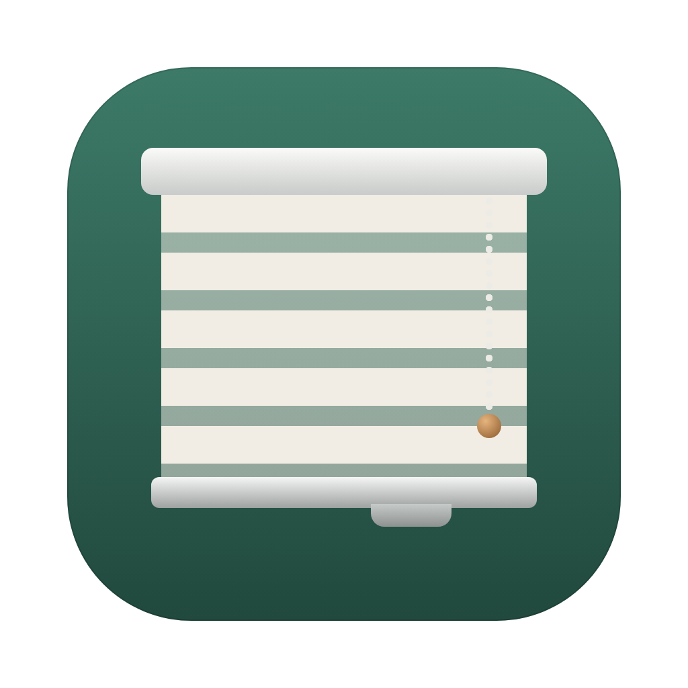
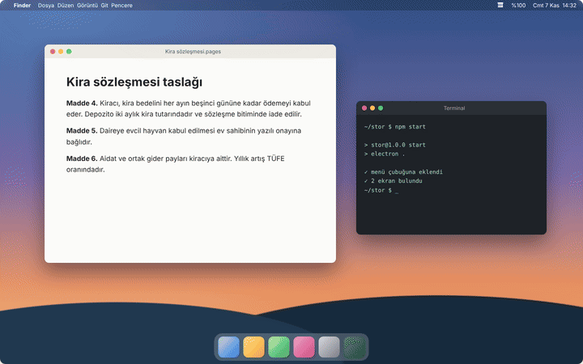
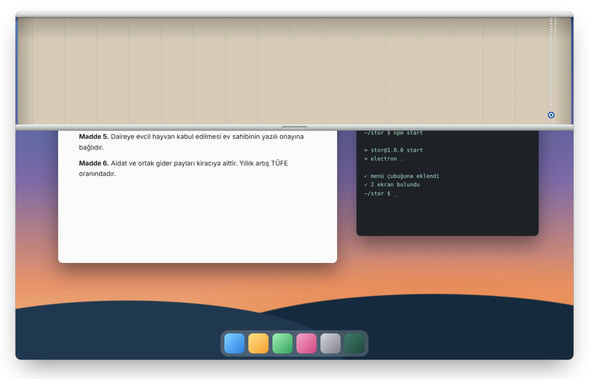
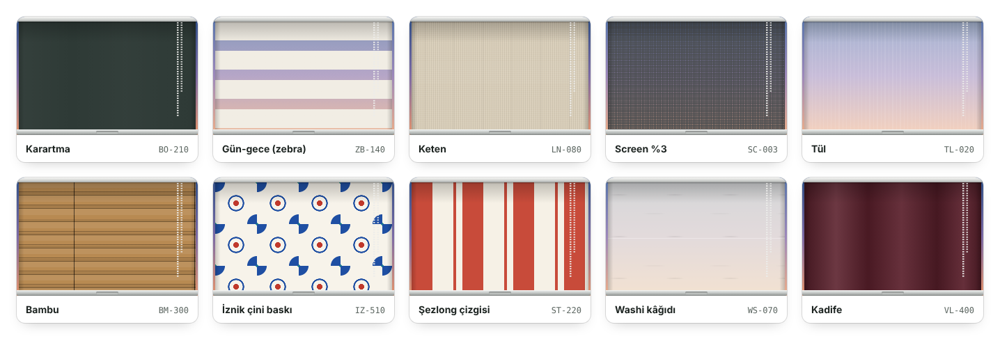
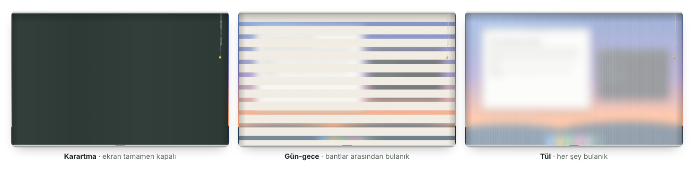
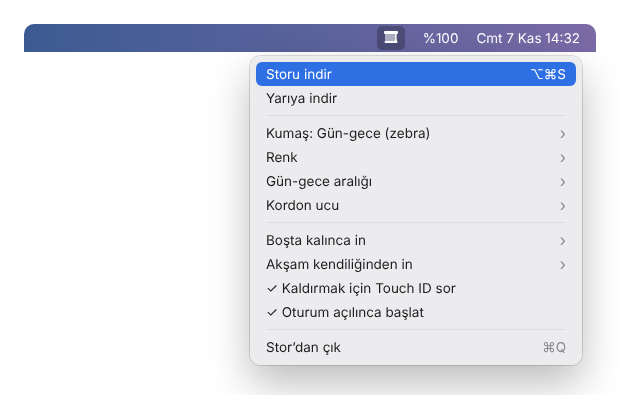

<p align="center">
  
</p>

<h1 align="center">Stor</h1>

<p align="center">
  <b>Mac ekranın için stor perde.</b><br>
  Kalkarken zinciri çek, stor insin. Döndüğünde alt çıtadan tut, yukarı sar.
</p>

<p align="center">
  
</p>

Stor menü çubuğunda duran küçük bir Mac uygulaması. Ekranının üstüne gerçek bir stor perde indirir: kaseti, kumaşı, alüminyum alt çıtası ve boncuklu zinciriyle. Masadan kalkarken ekranını örtmek, toplantıda ekranındakini gizlemek ya da akşam olunca bilgisayara "mesai bitti" demek için.

<p align="center">
  
</p>

## Özellikler

| | |
|---|---|
| **Zincirle ya da kısayolla** | ⌥⌘S ile, menü çubuğu simgesinden ya da storun sağındaki zinciri tıklayarak indir, kaldır. |
| **İstediğin yükseklikte** | Alt çıtadan tutup sürükle. Stor bıraktığın yerde kalır; en üste çekince kasete sarılıp kaybolur. |
| **10 kumaş** | Karartmadan tüle, bambudan İznik çinisine. Her kumaşın kendi renkleri var. |
| **Gün-gece aralığı** | Zebra storda bantların arasını daralt ya da genişlet. |
| **Boşta kalınca iner** | Bilgisayarı 1 ile 30 dakika arası kullanmazsan stor kendiliğinden iner. |
| **Akşam kendiliğinden iner** | 17:00 ile 21:00 arası seçtiğin saatte, her gün bir kez iner. |
| **Touch ID ile kaldır** | İstersen tamamen inmiş stor, parmak izin okunmadan kalkmaz. |
| **Her ekrana ayrı stor** | Bağlı her monitöre kendi storu iner, her biri ayrı yükseklikte durabilir. |
| **Kordon uçları** | Zincirin ucuna ahşap boncuk, pirinç top, püskül, nazar boncuğu, seramik damla ya da mermer küp as. Stor hareket edince sallanır. |

## Kumaş kartelası

<p align="center">
  
</p>

| Kumaş | Kod | Ekranı ne kadar kapatır |
|---|---|---|
| Karartma | BO-210 | Tamamen |
| Gün-gece (zebra) | ZB-140 | Bantlar tamamen, aralıklar bulanık |
| Keten | LN-080 | Tamamen |
| Screen, açıklık %3 | SC-003 | Arkası çok bulanık görünür |
| Tül | TL-020 | Arkası bulanık görünür |
| Bambu | BM-300 | Tamamen |
| İznik çini baskı | IZ-510 | Tamamen |
| Şezlong çizgisi | ST-220 | Tamamen |
| Washi kâğıdı | WS-070 | Arkası bulanık görünür |
| Kadife | VL-400 | Tamamen |

Yarı saydam kumaşlar arkadaki ekranı macOS'un kendi bulanıklık efektiyle gösterir. Pencerelerin yeri seçilir ama yazılar okunmaz.

<p align="center">
  
</p>

## Menü

Bütün ayarlar menü çubuğundaki stor simgesinde. Stor Dock'ta görünmez.

<p align="center">
  
</p>

## Kurulum

1. Mac'ine uygun zip'i al (aşağıdaki "Paket üretmek" adımıyla da üretebilirsin):
   - **Stor-mac-apple-silicon.zip**: M1, M2, M3, M4 çipli Mac'ler
   - **Stor-mac-intel.zip**: Intel işlemcili Mac'ler

   Hangisi olduğunu bilmiyorsan:  menüsü > Bu Mac Hakkında. "Çip" satırında "Apple M…" yazıyorsa Apple Silicon.
2. Zip'i aç, **Stor.app**'i **Uygulamalar** klasörüne sürükle.
3. Terminal'i aç (Spotlight'ta "Terminal" yaz) ve şu iki komutu sırayla yapıştır:

   ```bash
   xattr -cr /Applications/Stor.app
   ```

   ```bash
   codesign --force --deep --sign - /Applications/Stor.app
   ```

   Stor bir Apple geliştirici hesabıyla imzalanmadığı için bu adım gerekiyor. Birinci komut internetten indirilen dosyaya konan karantina işaretini kaldırır, ikincisi uygulamayı senin Mac'inde imzalar. Yapılmazsa macOS "Stor hasarlı" diyebilir.
4. Stor'u Uygulamalar'dan aç. Menü çubuğunun sağında stor simgesi belirir, ilk açılışta stor yarıya kadar iner.

**Gereksinim:** macOS 11 veya üstü.

## Kaynaktan çalıştırmak

[Node.js](https://nodejs.org) 20 veya üstü gerekir.

```bash
git clone https://github.com/sedakras/stor.git
```

```bash
cd stor && npm install
```

```bash
npm start
```

### Paket üretmek

```bash
npm run build
```

`dist/` klasörüne `Stor-mac-apple-silicon.zip` ve `Stor-mac-intel.zip` dosyalarını üretir. Paketleme Linux'ta da çalışır.

## Proje yapısı

```
main.js       Menü çubuğu, ekran başına stor penceresi, sürükleme, zamanlayıcılar, Touch ID
blind.html    Storun çizimi: kaset, kumaşlar, alt çıta, zincir ve kordon uçları
preload.js    Pencere ile ana süreç arasındaki köprü
build.js      Apple Silicon ve Intel paketlerini üretir
assets/       Uygulama ve menü çubuğu ikonları
tools/        İkonları ve README görsellerini üreten betikler
docs/         README görselleri
```

Ayarlar `~/Library/Application Support/Stor/settings.json` dosyasında tutulur.

## Görseller hakkında

Bu sayfadaki görseller `node tools/readme-shots.js` ile üretildi. Storun kendisi uygulamanın kullandığı `blind.html` çizimi; arkasındaki masaüstü, pencereler ve menü örnek olarak çizildi. Yarı saydam kumaşlardaki bulanıklık Mac'te macOS'un kendi efektiyle oluşur, görsellerde ona benzetildi.
